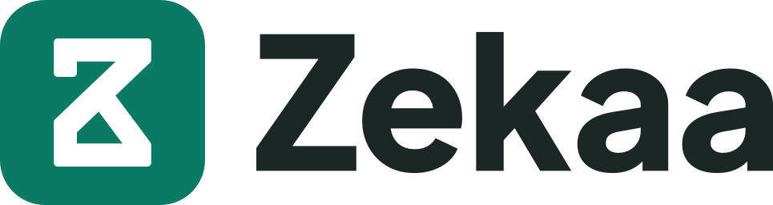

# Logo Zekaa

<picture>
  <source media="(prefers-color-scheme: dark)" srcset="logo/horizontal/zekaa-logo-horizontal-dark.svg">
  
</picture>

Berkas resmi logo Zekaa, platform untuk lembaga zakat yang menghimpun, mengelola, dan menyalurkan dana.

Zekaa memakai satu logo: mark Z, E, dan K di dalam ubin Arus, diikuti kata Zekaa. Produk Zekaa Give, Zekaa Flow, Zekaa Impact, Zekaa Care, dan aplikasi Zekaaqu memakai logo yang sama dengan nama masing-masing.

Pemakaian merek diatur di [TRADEMARK.md](TRADEMARK.md).

## Berkas

| Folder | Isi | Dipakai untuk |
|---|---|---|
| [logo/horizontal/](logo/horizontal/) | `[ubin] Zekaa`, lima varian warna | Header situs, dokumen, slide, email |
| [logo/stacked/](logo/stacked/) | Ubin di atas kata, lima varian warna | Sampul, kartu, poster, bidang persegi |
| [tile/](tile/) | Ubin saja: Arus, inverse, hitam, putih, dan `square` tanpa sudut bundar | Favicon, app icon, avatar. `square` untuk platform yang memotong sudut sendiri |
| [mark/](mark/) | Mark lepas: Arus, hitam, putih | Bidang besar tanpa kata: banner, merchandise, tanda air |
| [web/](web/) | `favicon.svg`, `favicon.ico`, PNG favicon 16/32/48, `apple-touch-icon.png`, PNG PWA 192/512, `maskable-512.png`, `site.webmanifest`, `head-snippet.html` | Ikon situs |
| [png/](png/) | Ubin, avatar, mark, dan logo dalam resolusi tinggi | Aplikasi yang tidak menerima SVG |
| [guidelines/](guidelines/) | Aturan pemakaian, warna, konstruksi, alasan desain | |
| [build/](build/) | Sumber geometri dan script build | Membangun ulang semua berkas |

## Varian warna

Logo mendatar dan bertumpuk masing-masing punya lima varian warna.

| Akhiran | Untuk latar | Ubin | Mark | Kata |
|---|---|---|---|---|
| tanpa akhiran | putih atau terang | Arus | putih | Arang |
| `-dark` | Arang atau gelap | Arus | putih | putih |
| `-inverse` | Arus | putih | Arus | putih |
| `-black` | cetak satu tinta | hitam, mark dilubangi | | hitam |
| `-white` | cetak satu tinta di latar gelap | putih, mark dilubangi | | putih |

## Panduan

- [Pemakaian](guidelines/usage.md): empat bentuk logo, satuan u, jarak aman, ukuran minimum, larangan
- [Warna](guidelines/color.md): Arus, Arus terang, Arang, dan warna per latar
- [Konstruksi](guidelines/construction.md): ukuran mark dan susunan lockup
- [Keputusan desain](guidelines/decisions.md): alasan bentuk dan percobaan yang ditolak

## Favicon di situs

Salin isi [web/](web/) ke akar situs, lalu tempel [web/head-snippet.html](web/head-snippet.html) ke `<head>`.

## Membangun ulang

Semua SVG dibangun dari [build/mark.txt](build/mark.txt) (path mark) dan [build/wordmark.txt](build/wordmark.txt) (kata Zekaa sebagai kurva). Ubah kedua sumber itu, bukan SVG hasilnya.

```sh
python3 build/build.py
python3 build/render.py
```

`build.py` hanya butuh Python 3. `render.py` membuat PNG dan `favicon.ico` lewat Google Chrome atau Chromium headless.

Kata Zekaa digambar dari [Plus Jakarta Sans](https://github.com/tokotype/PlusJakartaSans) ExtraBold (800), dengan kerning bawaan font dan tracking −0,012 em, lalu diubah menjadi kurva. Font itu berlisensi SIL Open Font License ([build/OFL-PlusJakartaSans.txt](build/OFL-PlusJakartaSans.txt)).
